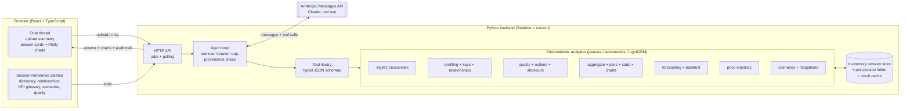

# Demand Planning Analyst

A locally hosted AI demand-planning data scientist. Upload a multi-table dataset (a ZIP of Excel/CSV files, one file per table), ask questions in plain English, describe external events (tariffs, supplier failures, disasters...), and get validated weekly forecasts, quantified scenario impacts, charts and recommendations.

**The LLM never computes numbers.** Claude decides which tools to call and explains their results; every number comes from deterministic Python analytics, a user-supplied input, or a labelled assumption. The app checks this automatically and flags any number in an answer that cannot be traced to a tool result.

---

## Quick start (Windows, macOS, Linux)

1. Install **uv** (once): <https://docs.astral.sh/uv/getting-started/installation/>
   Windows PowerShell: `powershell -ExecutionPolicy ByPass -c "irm https://astral.sh/uv/install.ps1 | iex"`
2. In the project folder, create your `.env`:
   ```
   copy .env.example .env        (Windows)
   cp .env.example .env          (macOS/Linux)
   ```
   Put your key in it: `ANTHROPIC_API_KEY=sk-ant-...` (optionally change `ANTHROPIC_MODEL`).
3. Start everything with **one command**:
   ```
   uv run python start.py
   ```
   uv installs Python and all packages on the first run (1-3 minutes), then the app opens at <http://127.0.0.1:8000>.
4. Click **Load demo data** (runs the bundled ZIP of Excel files through the normal upload pipeline) or **Upload files**.

Run the tests: `uv run pytest`
End-to-end check against a running app: `uv run python tests/e2e_flow.py --base http://127.0.0.1:8000`

The frontend is shipped pre-built in `frontend/dist`, so Node.js is **not** needed to run the app. To change the UI: `cd frontend && npm install && npm run build`.

---

## Architecture



**Request flow for a question.** The UI posts the message and gets a job id. The agent builds a system prompt from fixed rules plus the live session context: tables, relationships, the demand definition, scenarios, the assumptions log, and KPIs and results used so far. It then calls Claude with the tool library. Claude calls tools, the backend runs them and returns structured results, and this repeats until Claude calls `final_answer`, capped at 12 rounds and 240 s. The answer, charts, KPI usage and the full list of tool calls (parameters, timing, results) are stored and rendered. The UI polls the job and shows each step as it runs.

### Tool library (all deterministic, JSON-schema typed)

| Area | Tools |
|---|---|
| Data | `list_tables`, `profile_tables`, `infer_relationships`, `confirm_relationships`, `join_tables`, `data_quality_report` (upload itself is the `load_upload` pipeline in `ingest.py`, run by the upload endpoint) |
| Descriptive | `aggregate` (group / filter / time-bucket with automatic many-to-one joins), `descriptive_stats`, `make_chart`, `detect_outliers`, `calculate` (exact arithmetic so the model never does maths) |
| Forecasting | `forecast_weekly`, `backtest`, `compare_models`, `forecast_chart` |
| Inventory & promotions | `inventory_plan`, `inventory_chart`, `estimate_promo_lift` |
| Scenarios | `estimate_price_elasticity`, `create_scenario`, `confirm_scenario`, `apply_scenario`, `compare_scenarios`, `sensitivity_analysis`, `supplier_cost_impact`, `financial_impact`, `evaluate_mitigations` |
| Output | `final_answer` (structured 8-part response) |

### Code map

```
start.py                     one-command launcher (loads .env, starts uvicorn, opens browser)
backend/dpa/
  ingest.py                  ZIP/CSV/Excel loading, guardrails, header detection, name standardisation
  profiling.py               types, units, granularity, primary-key inference, data dictionary
  relationships.py           foreign-key inference (single, composite, attribute links), validated joins
  semantic.py                which table/columns play which planning role (shown to the user)
  quality.py, timeseries.py  quality report, seasonal adjustment, outliers, level shifts, stockouts
  events.py                  resolves which external events apply to which SKUs (polymorphic scope)
  analytics.py, charts.py    aggregation with auto-joins, stats, Plotly figure JSON
  forecasting.py             baselines, ETS, LightGBM, rolling-origin backtest, intervals
  elasticity.py              log-log fixed-effects price elasticity with cluster-robust CIs
  scenarios.py               scenario objects, landed cost, impact, sensitivity, mitigations
  kpis.py                    KPI & formula glossary entries
  tools.py, agent.py         tool registry + agent loop + number-provenance check
  server.py, session.py      HTTP API, background jobs, session store
frontend/                    React + TypeScript UI (bundled with esbuild into frontend/dist)
data/demo/demo_data.zip      bundled demo dataset (one Excel workbook per table)
tests/                       pytest unit tests + end-to-end script
```

---

## What's new (v1.1)

| Area | Feature |
|---|---|
| Analytics | **Reorder & stockout plan** (`inventory_plan`): safety stock sized from the forecast's measured error, order-up-to level over lead time + review period, orders rounded to case pack and MOQ, projected on hand with scheduled PO receipts, items that must be expedited |
| Analytics | **Promotion lift** (`estimate_promo_lift`): demand lift by promotion type or discount depth, post-promotion dip, 95% CIs, per category |
| Analytics | **Croston/SBA** forecasts for intermittent demand, plus a WAPE breakdown by demand class (smooth / erratic / intermittent / lumpy) |
| Product | **Saved workspaces**: data, chats, scenarios, assumptions and edits survive a restart (`.sessions/<id>/`); switch, rename, delete from the header |
| Product | **Optional password**: set `APP_PASSWORD` in `.env` |
| UI | Dark mode (system / light / dark), **Download data (Excel)** on every answer, CSV endpoints, **Save as PDF** (print-ready conversation), starter questions, **Stop** button for long answers |

## Data handling and quality

- **ZIP upload:** each archive is extracted into a per-session folder. Entries with `..` or absolute paths are rejected, and a zip-bomb guard limits the archive to 1 GB uncompressed and 500 entries. System files (`__MACOSX/`, `.DS_Store`, `~$` lock files, hidden files) are skipped with the reason shown. Nested folders are searched for tables, and every `.csv`, `.xlsx` and `.xls` file becomes a table named after the file in snake_case.
- **Multi-sheet workbooks:** these are held back, and the UI asks whether to load only the first sheet or each sheet as its own table.
- **Duplicate table names:** when two files map to the same name (e.g. `sales.csv` and `sales.xlsx`), the CSV is kept and the two copies are compared cell by cell. A mismatch is reported as a warning.
- **Cleaning:** header rows are detected (title rows above the table are skipped), blank rows and columns are trimmed, and column names are standardised. The original names stay in the data dictionary. Dates, months, currency symbols, thousands separators and percent signs are parsed. Leading-zero IDs stay as text.
- **Bad files:** unreadable, corrupt, empty or password-protected files are reported one by one and never fail the whole upload.
- **Keys and joins:** primary keys are inferred as the smallest unique combination of ID and date columns. Foreign keys are inferred from name matches with at least 95% value coverage, including composite keys such as (sku_id, supplier_id). "Attribute" links (e.g. competitor price by `category`) are flagged as *aggregate first*. All of these are shown to the user for confirmation.
- **Join checks:** every join reports row counts before and after, key uniqueness, orphan keys, **fan-out** (warning; automatic joins refuse to proceed) and **grain mismatch**. For example, inventory has no channel, so joining it to sales repeats stock levels on each channel row. The app warns not to sum them.
- **Time-series checks:** missing weeks inside each series, duplicates, zero or negative demand, short histories, new and discontinued SKUs, level shifts and structural breaks (seasonally adjusted, ±26-week window, Welch t > 5), partial years, and identity checks such as sold + lost = demand.
- **Outliers:** a robust z-score on the seasonally adjusted log series (13-week rolling-median trend plus median week-of-year effect). A week is flagged when |z| > 3.5 and it is at least 5 units off. Flags are **never deleted**. Each one is explained by promotions, calendar events and in-scope external events. Cap and impute treatments can be previewed with their effect on totals, or applied inside a forecast.
- **Stockouts:** when a stockout flag or lost-sales column exists, zero sales during a stockout are treated as censored. Otherwise, zero sales with no available stock in inventory are flagged. The default forecast target is unconstrained `customer_demand`, so stockouts don't drag the forecast down.

## Forecasting and validation

- **Target:** any additive weekly planning measure (demand, units sold, revenue, PO quantity, returns...) at total, category, SKU or any dimension level.
- **Baselines (always computed):** naive, seasonal naive (52-week lag), and an 8-week moving average.
- **Candidate models:**
  - **ETS / Holt-Winters** (statsmodels): additive damped trend, plus additive 52-week seasonality when there are at least 2 years of history.
  - **LightGBM:** one global model across series, using a **direct multi-horizon** strategy. Each training row is a (forecast origin, horizon) pair whose features use only information available at the origin: recent level, last value, same week last year, last year's level, week of year, holiday and shopping-event flags, planned promotion share and discount, and price index. The target is log demand relative to the recent level. Because no forecast is fed back in as an input, errors don't compound after peaks such as Black Friday.
- **Backtest:** rolling origin inside a 52-week holdout (origins every 13 weeks, 13-week horizon). Every model is refit at each origin using only earlier data.
- **Metrics:** WAPE, MAE, RMSE, bias and MASE (scaled by the in-sample seasonal-naive error). MAPE is reported with the number of zero-demand weeks it had to exclude.
- **Model choice:** the candidate with the lowest WAPE is recommended **only if it beats the best baseline**; otherwise the baseline is recommended and the answer says so. A guardrail warns if the chosen forecast differs from seasonal naive or ETS by more than 25%.
- **Prediction intervals** are empirical: quantiles of the backtest's actual/forecast ratios, pooled by horizon band (weeks 1-4, 5-8, 9-13). Each band therefore reflects how wrong that model really was on this data.
- **Caching:** results are cached per session. After every upload, the SKU-level forecast used by scenarios is pre-computed in the background.

## Scenario logic: computed vs estimated vs assumed

1. **Parse, then confirm.** The model turns the event description into a structured scenario: event type, scope (suppliers, countries, SKUs, categories, brands, DCs), dates, tariff or cost change, capacity change, lead-time change, price pass-through, demand effect and its source, horizon, and cost timing. It starts as a **draft**. The app shows what the scope resolves to (SKU × supplier pairs) and the default assumptions, and **cannot be applied until the user confirms** (`apply_scenario` refuses drafts).
2. **Direct, computable effects first:**
   - Landed cost per SKU × supplier = recent quantity-weighted PO unit cost × (1 + tariff) + freight per unit.
   - The new tariff is added in percentage points by default, or replaces the current rate.
   - Costs are blended across suppliers by sourcing share.
   - Cost timing is FIFO by default: stock on hand plus open POs landing before the effective date were bought at the old cost.
3. **Demand effects only if defensible:** either a price elasticity estimated from the data (log-log, SKU fixed effects, Fourier seasonality, cluster-robust 95% CI, used only when marked *usable*), or a value the user supplies. Otherwise the demand effect stays **none**, and a sensitivity table (e.g. demand 0 / −5 / −10 / −20%) is shown labelled *hypothetical*. On the demo data the promotional elasticity is clearly negative (about −3), but list-price-only elasticity is not statistically different from zero. The app therefore says it cannot estimate the response to a permanent price rise, rather than applying −3.
4. **Every disruption answer has four parts:**
   - Expected under normal conditions.
   - What changes, with delta KPIs and side-by-side charts.
   - What is affected: SKUs, suppliers and countries ranked by exposure.
   - Mitigations: shift volume to already-contracted alternate suppliers (checked against capacity headroom, lead time and MOQ); pre-buy (checked against lead time versus days to the effective date, with air expedite using historical air freight costs); re-price; safety stock (square-root lead-time rule).
   - Anything the data cannot evaluate, such as qualifying a new supplier, is marked as such.
5. **Badges:** every KPI carries a **Computed** / **Estimated** / **Assumed** badge.
   - **Computed:** from data plus the stated event parameters, e.g. landed cost per unit.
   - **Estimated:** depends on a model, e.g. totals over the horizon built on forecast units.
   - **Assumed:** user-supplied or hypothetical values.
   - Every assumption is logged in the sidebar with its source and the time it was added.

## Trust features

- **Number provenance check.** Every number in the answer, key results and recommendations is matched (within its displayed precision) against all tool outputs, the user's messages, scenario parameters and the assumptions log. Numbers that can't be traced are flagged in the UI. Years, dates, single digits and week durations are exempt.
- **Audit trail.** "How this was computed" expands to every tool call with its parameters, duration and result.
- **Session KPI glossary.** It contains only the KPIs actually used. Each entry shows its KaTeX formula, a worked example using this session's numbers, input tables and columns, period and level, what good looks like, caveats, and links back to the answers that used it.

## Technology choices

| Choice | Why |
|---|---|
| **Python analytics** (pandas, statsmodels, scikit-learn, LightGBM, scipy) | Standard, well-documented libraries the team can defend; all maths is deterministic and unit-tested. |
| **Starlette + uvicorn** | The lightweight ASGI framework FastAPI is built on. We need about 15 JSON routes, multipart upload and static files. Starlette provides these without an extra layer, and was available offline in the build environment. Moving to FastAPI is mechanical (same request and response objects). |
| **Background jobs + polling** | Uploads, forecasts and agent turns can take 5-60 s. Polling a job endpoint is simpler and more robust in a classroom (no websockets or proxies) and shows each step as it runs. |
| **Anthropic Messages API with tool use** | The model plans and explains; tools compute. The model is set in `.env` (`ANTHROPIC_MODEL`), and the key is read from `.env`, never hard-coded. Prompt caching is used on the rules and tool definitions. |
| **In-memory session store + per-session folder** | Data sizes (about 110k rows) fit comfortably in memory. pandas joins are fast enough, so **DuckDB was not needed**; every join goes through `validated_join` for the row-count and fan-out checks. |
| **React + TypeScript, bundled with esbuild** | esbuild is the bundler Vite uses internally. A single build script gives one static bundle that the backend serves, so users don't need Node.js. |
| **Plotly** | Figures are built as Plotly JSON in Python and rendered by plotly.js in the browser. plotly.js is served locally from the Python `plotly` package, so charts work without internet access. |
| **KaTeX, marked** | Formula rendering in the glossary; markdown in answers (raw HTML from the model is never rendered). |
